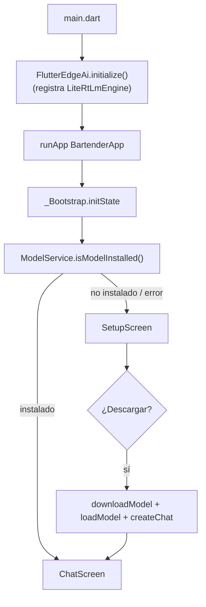
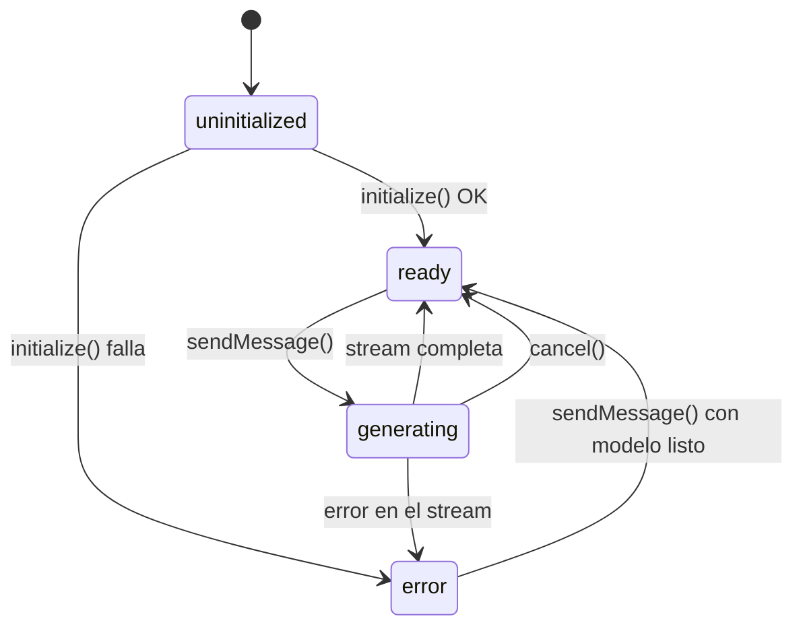
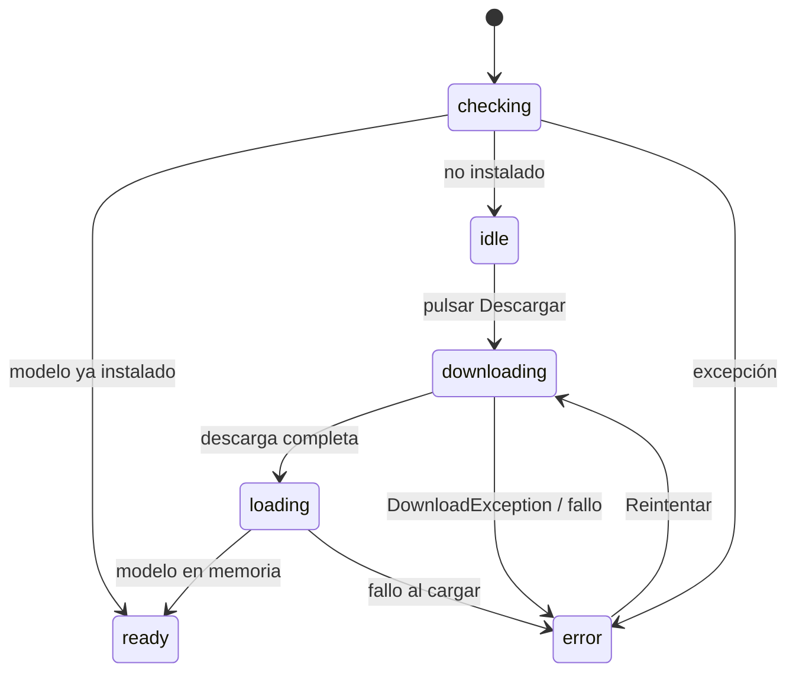

# Arquitectura — Bartender On Device

Este documento explica **cómo está construida y cómo funciona** la app a alto nivel. Para el detalle línea a línea de cada archivo, ver [`CODE_WALKTHROUGH.md`](CODE_WALKTHROUGH.md). Para problemas conocidos y soluciones, ver [`TROUBLESHOOTING.md`](TROUBLESHOOTING.md).

---

## 1. Qué es la app

Un asistente de cócteles que corre **100 % en el dispositivo**. La primera vez descarga un modelo de lenguaje (Gemma 4 E2B, ≈ 2.59 GB) desde Hugging Face; a partir de ahí la inferencia ocurre localmente con **LiteRT LM**, sin servidores y sin enviar datos a la nube.

- **Entrada**: texto libre del usuario en un `TextField`.
- **Salida**: respuesta en streaming, token a token, renderizada como Markdown.
- **Persistencia**: historial de chat en `shared_preferences`.
- **Ámbito de dominio**: el "system prompt" limita al modelo a temas de coctelería.

Stack técnico:

| Capa | Tecnología |
| --- | --- |
| UI / app | Flutter (Material 3, tema oscuro) |
| Runtime LLM | `flutter_edge_ai` + `flutter_edge_ai_litertlm` (LiteRT LM) |
| Modelo | `gemma-4-E2B-it.litertlm` (`ModelType.gemma4`) |
| Persistencia | `shared_preferences` |
| Markdown | `flutter_markdown_plus` |
| Enlaces | `url_launcher` |

---

## 2. Capas y responsabilidades

El código se organiza en tres capas. La regla es: **la UI no habla con el motor de IA directamente**, siempre pasa por el controlador y el servicio.

```
lib/
├── main.dart                  # Punto de entrada: inicializa el engine y arranca la app
│
├── app/                       # Capa de aplicación (arranque y aspecto global)
│   ├── app.dart               # MaterialApp + _Bootstrap (decide qué pantalla mostrar)
│   └── theme.dart             # Tema Material 3 oscuro (seed color cobre)
│
├── core/                      # Capa de dominio / infraestructura (sin UI)
│   ├── model/
│   │   ├── model_service.dart        # Singleton: descarga, carga y ciclo de vida del modelo
│   │   └── model_config.dart         # Sealed ModelConfig + GemmaModel (URL, tipo, límites)
│   ├── persona/
│   │   └── cocktail_system_prompt.dart # Persona + reglas que recibe el modelo
│   └── storage/
│       └── chat_storage.dart         # Persistencia del historial en shared_preferences
│
└── features/chat/             # Capa de feature (todo lo del chat)
    ├── models/
    │   ├── chat_controller.dart       # Estado del chat (ChangeNotifier)
    │   └── chat_message.dart          # Modelo de mensaje + (de)serialización JSON
    └── ui/
        ├── chat_screen.dart           # Pantalla principal de conversación
        ├── setup_screen.dart          # Pantalla de primera ejecución / descarga
        └── widgets/                   # Widgets de presentación
            ├── input_bar.dart         # Campo de texto + botón enviar/detener
            ├── message_bubble.dart    # Burbuja de mensaje con Markdown
            ├── empty_state.dart       # Estado vacío con sugerencias
            ├── typing_indicator.dart  # Animación "escribiendo…"
            └── model_status_card.dart # Tarjeta de estado del modelo (descarga/carga)
```

**Regla de dependencias (de arriba hacia abajo):**

```
main.dart
   └── app.dart ──► features/chat/ui ──► features/chat/models ──► core/model + core/persona + core/storage
```

Ningún archivo de `core/` importa UI. Ningún widget importa `flutter_edge_ai` salvo `setup_screen.dart` (solo para el tipo `DownloadException`).

---

## 3. Flujo de arranque



1. `main.dart` inicializa el engine de inferencia **antes** de `runApp`.
2. `_Bootstrap` (en `app.dart`) comprueba si el modelo ya está en disco.
3. Si ya está → abre el chat; si no → abre la pantalla de setup, que descarga y carga el modelo y luego navega al chat.

---

## 4. Flujo de una conversación (streaming)

```mermaid
sequenceDiagram
    participant U as Usuario
    participant IB as InputBar
    participant CS as ChatScreen
    participant CC as ChatController
    participant GS as ModelService
    participant LM as LiteRT LM (nativo)

    U->>IB: escribe y pulsa enviar
    IB->>CS: onSend(text)
    CS->>CC: sendMessage(text)
    CC->>CC: añade mensaje usuario + burbuja asistente vacía
    CC->>GS: sendMessageStream(chat, text)
    GS->>LM: addQueryChunk(Message.text)
    GS->>LM: generateChatResponseAsync()
    loop por cada token
        LM-->>GS: TextResponse(token)
        GS-->>CC: token (Stream)
        CC->>CC: assistantMessage.text += token; notifyListeners()
        CC-->>CS: rebuild + autoscroll
    end
    CC->>CC: marca done y persiste historial
```

Puntos clave:

- El **estado vive en `ChatController`** (`ChangeNotifier`). La UI se limita a escuchar y reconstruir.
- El streaming se implementa con `async*` (un `Stream<String>` de tokens). El `for await` en el controlador añade cada token al último mensaje del asistente.
- El autoscroll se dispara tras cada `notifyListeners()` en un `addPostFrameCallback`.

---

## 5. Máquinas de estado

### 5.1 `ChatPhase` (estado global del chat)

Vive en `chat_controller.dart`.



| Estado | Significado | Efecto en la UI |
| --- | --- | --- |
| `uninitialized` | Cargando historial y modelo | Sin mensajes / spinner |
| `ready` | Modelo cargado y ocioso | `InputBar` habilitada |
| `generating` | El modelo está produciendo tokens | `InputBar` deshabilitada, botón "Detener", `TypingIndicator` |
| `error` | Falló init o el stream | Banner de error |

Además hay un flag independiente `isModelReady` (booleano) que indica si el modelo terminó de cargar; se usa para bloquear el envío con un mensaje claro.

### 5.2 `SetupStatus` (estado de la pantalla de setup)

Vive en `model_status_card.dart` y se controla desde `setup_screen.dart`.



---

## 6. Ciclo de vida del modelo (`ModelService`)

`ModelService` es un **singleton** (`ModelService.instance`). Motivo: solo debe existir **una** copia del modelo en memoria (≈ 2.59 GB) y un único `InferenceChat` con el contexto de conversación. Es **agnóstico del modelo**: todo lo concreto sale de `ModelService.instance.config` (un `ModelConfig`, por defecto `GemmaModel`).

| Método | Qué hace | Notas |
| --- | --- | --- |
| `isModelInstalled()` | Consulta si el archivo existe en disco | Vía `FlutterEdgeAi.isModelInstalled`, usando `config.fileName` |
| `downloadModel()` | Descarga el `.litertlm` con progreso y token opcional | Builder `installModel(...).fromNetwork(...).withProgress(...)` |
| `loadModel()` | Carga el modelo en memoria y devuelve `InferenceModel` | Backend `config.preferredBackend` (`gpu`, con fallback) |
| `createChat({systemInstruction})` | Crea el `InferenceChat` con la instrucción recibida | `config.topK` (1, greedy) y `config.maxOutputTokens` |
| `sendMessageStream()` | Añade el prompt y hace streaming de tokens | `async*` sobre `TextResponse` |
| `cancel()` | Detiene la generación en curso | `stopGeneration()` |
| `resetChat()` | Cierra el chat y lo pone a `null` | Se usa al "Borrar conversación" |
| `dispose()` | Cierra chat y modelo | Se llama al desmontar el `ChatController` |

**Por qué `topK: 1`**: se elige decodificación *greedy* (siempre el token más probable) para respuestas deterministas y coherentes en recetas. **Por qué `maxOutputTokens`**: acota la longitud para no agotar el contexto (`contextTokens`) ni bloquear el dispositivo. Ambos son parte de la config del modelo, no del servicio.

**Por qué la persona va aparte**: el `systemInstruction` (la persona de bartender) es específico de esta app, no del modelo. Por eso `ModelService` lo recibe como parámetro y vive en `core/persona/`.

---

## 7. Persistencia

`ChatStorage` guarda el historial como una única cadena JSON bajo la clave `chat_history_v1` en `shared_preferences`.

- Solo se persisten mensajes **terminados** (status ≠ `streaming`); ver `ChatController._persist()`.
- `chat_message.dart` define `chatMessagesToJson` / `chatMessagesFromJson`, con `orElse` defensivo al deserializar (si el JSON está corrupto, cae a valores por defecto en vez de lanzar).

### ¿Por qué `shared_preferences` y no una base de datos?

El historial es una lista corta de mensajes de texto; no hace falta consultar ni indexar. `shared_preferences` evita dependencias nativas extra y es multiplataforma. Si el historial creciera mucho, sería el primer candidato a migrar a SQLite (`sqflite`).

---

## 8. Web vs. nativo

- **Nativo (iOS/Android/macOS/desktop)**: usa `gemma-4-E2B-it.litertlm` con el engine nativo.
- **Web**: el engine LiteRT-LM se inicializa igual (módulos `cache_api.js`, `opfs_helper.js` y `@litert-lm/core` cargados en `web/index.html`), pero **el archivo nativo `.litertlm` no se ejecuta en el navegador**; se necesita un export `-web.litertlm` del modelo. Ver `TROUBLESHOOTING.md`.

`main.dart` pasa `webStorageMode: WebStorageMode.streaming` para que, en web, la descarga del modelo se haga en streaming en lugar de cargar todo en memoria de golpe.

---

## 9. Decisiones de diseño (resumen)

| Decisión | Alternativa descartada | Motivo |
| --- | --- | --- |
| Singleton para el modelo | Instanciarlo por pantalla | El modelo pesa GB; una sola copia |
| `ModelConfig` sellado + `GemmaModel` | Constantes `k*` sueltas | Aísla lo específico del modelo y deja un punto de extensión limpio |
| `systemInstruction` como parámetro | Persona dentro del servicio | El servicio es agnóstico del dominio; la persona es de la app |
| `ChangeNotifier` | Riverpod / Bloc | Suficiente para un estado simple; sin dependencias extra |
| `topK: 1` (greedy) | Muestreo aleatorio | Recetas deterministas y coherentes |
| Persistir solo mensajes terminados | Persistir también en streaming | Evita guardar estados intermedios inconsistentes |
| `_Bootstrap` decide pantalla | Flag "onboarding" persistido | El disco es la fuente de verdad (si el archivo está, el modelo está) |
| Markdown en las burbujas | Texto plano | Las recetas usan listas y negritas; mejora la legibilidad |
